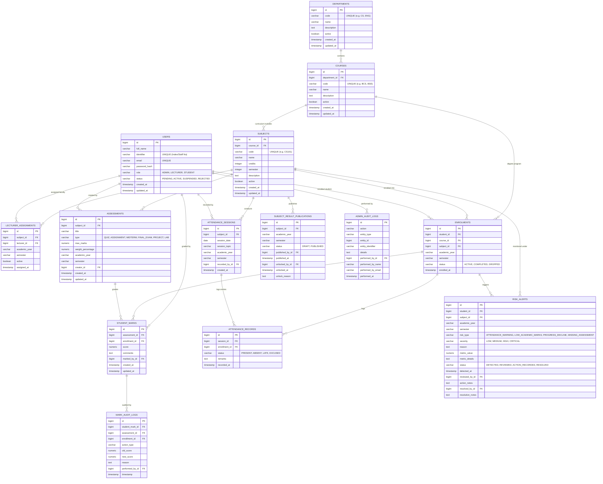

# Student Performance Analysis System (SPAS)

A full-stack enterprise university academic performance analysis, continuous assessment, attendance tracking, and early-warning intervention platform.

[](#testing--quality-assurance)
[](#testing--quality-assurance)
[](#testing--quality-assurance)
[](#technology-stack)
[](#technology-stack)
[](#technology-stack)
[](#technology-stack)
[](#technology-stack)

---

## 1. System Overview

The **Student Performance Analysis System (SPAS)** is designed for universities and academic institutions to manage academic structures, administer continuous assessments, calculate grades and GPA/CGPA, track student attendance, and trigger early interventions for students at risk of academic failure or attendance shortages.

### Core Modules & Functional Capabilities

```
┌────────────────────────────────────────────────────────────────────────┐
│               Student Performance Analysis System (SPAS)               │
├───────────────────┬───────────────────┬────────────────────────────────┤
│ Identity & Access │ Academic Hub      │ Evaluation & Grades            │
│ • Role-Based RBAC │ • Departments     │ • Continuous Assessments (CA)  │
│ • Admin Approval  │ • Degree Programs │ • Strict Ruhuna Grades (A-F,W) │
│ • BCrypt & JJWT   │ • Course Modules  │ • DRAFT / SUBMITTED / PUBLISHED│
│ • Secure Tokens   │ • Enrollments     │ • GPA / CGPA Calculation       │
├───────────────────┼───────────────────┼────────────────────────────────┤
│ Attendance Engine │ Risk Intervention │ Institutional Analytics        │
│ • Session Logs    │ • Low Attendance  │ • Performance Analytics        │
│ • Aggregate Rate  │ • Score Shortfall │ • Class Grade Distributions    │
│ • <80% Warning    │ • Deduplication   │ • CSV Data Exports             │
│ • Marks Decoupled │ • Status Workflow │ • Durable Admin Audit Trail    │
└───────────────────┴───────────────────┴────────────────────────────────┘
```

1. **Role-Based Access Control (RBAC):**
   - **Administrator (`ADMIN`):** Oversees user registration approvals, role assignments, department/course/subject setups, safe cascading deletions, risk alert monitoring, system analytics, and governance audit trails.
   - **Lecturer / Teacher (`LECTURER`):** Enters marks for assigned modules, creates and edits assessment breakdowns, tracks lecture attendance, submits grades for publication, and monitors module-level risk alerts.
   - **Student (`STUDENT`):** Views enrolled courses, published marks, semester GPA/cumulative CGPA transcripts, attendance percentage, and academic advisory notices.

2. **Self-Registration & Approval Lifecycle:**
   - New users self-register as `STUDENT` or `LECTURER`.
   - Accounts are placed into `PENDING_APPROVAL` state until explicitly reviewed and approved by an `ADMIN`.
   - Rejected or suspended accounts are barred from authenticating.
   - Users can track their approval status publicly using their university email and index number.

3. **Academic Structure & Enrollments (Full CRUD):**
   - Hierarchical data model: `Department` → `Course` (Degree Program) → `Subject` (Module) → `Enrollment`.
   - Full CRUD operations with client-side and server-side relational validation:
     - Department: Create, Read, Update, Activate/Deactivate, Safe Delete (refuses if child courses exist).
     - Course: Create, Read, Update, Activate/Deactivate, Safe Delete (refuses if child subjects exist).
     - Subject: Create, Read, Update, Activate/Deactivate, Safe Delete (refuses if active enrolments or assignments exist).
     - Lecturer Assignment & Student Enrolment: Create, Read, Update Status, Safe Delete.
   - Comprehensive Read controls: Real-time search across entity codes, names, and descriptions; multi-criteria filtering by department, course, semester, and status; column sorting (`▲`/`▼`); and detailed metadata inspection modals.

4. **Continuous Assessment & Grading Policy:**
   - Multi-component evaluations: Assignments, Quizzes, Midterms, Practicals, and Final Examinations.
   - Assessment weight allocation allows flexible composition $\le 100\%$, with full $100\%$ strictly required prior to final result publication.
   - **Strict Grade Assignment:**
     - **A:** Percentage $\ge$ 75.0% (Grade Point: 4.0)
     - **B:** Percentage $\ge$ 65.0% (Grade Point: 3.0)
     - **C:** Percentage $\ge$ 50.0% (Grade Point: 2.0)
     - **S:** Percentage $\ge$ 40.0% (Grade Point: 1.0 — Satisfactory / Pass)
     - **F:** Percentage $<$ 40.0% (Grade Point: 0.0 — Fail)
     - **W:** Withdrawn (Assigned *exclusively* when an enrollment is dropped; never assigned based on a numeric mark).
   - **Result Publication Lifecycle:**
     - `DRAFT`: Marks are editable by the lecturer.
     - `PUBLISHED`: Marks are finalized, released to students, and factored into official GPA/CGPA transcripts. Locked from faculty edits unless explicitly unlocked by an Administrator.

5. **Attendance Tracking & Decoupled Architecture:**
   - Conducted session-by-session with dates, session topics, and individual attendance flags (`PRESENT`, `ABSENT`, `LATE`, `EXCUSED`).
   - Attendance percentage is calculated dynamically based on total eligible sessions.
   - **Decoupled Design:** Attendance does *not* artificially manipulate numeric academic marks. Instead, attendance shortages trigger independent warnings and risk alerts.
   - An automated warning indicator highlights attendance below the institutional **80% threshold** required for examination eligibility.

6. **Early-Warning Risk Alert Engine:**
   - Detects academic distress:
     - **ATTENDANCE_WARNING:** Attendance falls below 80%.
     - **LOW_ACADEMIC_MARKS:** Continuous assessment or total marks fall below passing criteria ($< 40\%$).
     - **PROGRESS_DECLINE:** Significant drop in performance ($\ge 15\%$) compared to prior assessments.
     - **MISSING_ASSESSMENT:** Unsubmitted or unrecorded assessment items.
   - **Deduplication:** Prevents spamming instructors by guaranteeing that no duplicate open alert exists for the same student, subject, and reason.
   - **Resolution Workflow:** Alerts progress through `DETECTED` → `REVIEWED` → `ACTION_RECORDED` → `RESOLVED`.

7. **Institutional Analytics & Admin Audit Trail:**
   - Interactive charts and reports for grade distributions, pass/fail ratios, and class averages.
   - One-click CSV export utility for official institutional reporting.
   - Immutable administrative audit log (`admin_audit_logs`) tracking administrative actions (user approval, status transitions, role adjustments, curriculum modifications) with bounded database pagination.

---

## 2. Technology Stack

| Layer | Technologies |
|---|---|
| **Frontend** | React 19, TypeScript 5, Vite 8, Tailwind CSS v4, Vitest, Testing Library, Oxlint |
| **Backend** | Java 21 (Eclipse Adoptium), Spring Boot 4.1.1, Spring Security 6, Spring Data JPA, Hibernate ORM 7, JJWT 0.12.6, Flyway 11, Spring Boot Actuator |
| **Database** | PostgreSQL 16/17 (Production) / In-Memory H2 with PostgreSQL syntax mode (Integration Testing) |
| **Containerization** | Docker (multi-stage builds), Docker Compose, Nginx Alpine (Reverse Proxy & SPA Router) |
| **Build & Tooling** | Apache Maven (via Maven Wrapper `mvnw`), npm, oxlint |

---

## 3. Architecture & Repository Structure

```
student-performance-analysis-system/
├── backend/                              # Spring Boot REST API
│   ├── src/main/java/com/sahrin/spas/
│   │   ├── config/                       # Security, JWT, Database & Admin Initializer
│   │   ├── controller/                   # REST Controllers (Auth, Admin, Lecturer, Student, Reports)
│   │   ├── dto/                          # Request & Response Data Transfer Objects
│   │   ├── entity/                       # JPA Relational Entities (14 core tables)
│   │   ├── exception/                    # Global Exception Handler & Custom Errors
│   │   ├── repository/                   # Spring Data JPA Repositories
│   │   ├── service/                      # Business Logic & Grading Policy
│   │   └── util/                         # CSV Export and String Formatters
│   ├── src/main/resources/
│   │   ├── application.properties        # Local Development Configuration
│   │   ├── application-prod.properties   # Hardened Production Configuration (ddl-auto=validate)
│   │   └── db/migration/                 # Versioned Flyway SQL Migrations (V1, V2)
│   ├── src/test/                         # Comprehensive Backend Test Suite (290 tests)
│   └── pom.xml                           # Maven Dependencies & Build Setup
├── frontend/                             # React + TypeScript + Vite Single Page Application
│   ├── src/
│   │   ├── services/                     # Typed API client services with JWT bearer handling
│   │   ├── test/                         # Vitest + React Testing Library suites
│   │   ├── App.tsx                       # Root SPA Router, Live Metrics & Navigation Shell
│   │   ├── AdminAcademicHub.tsx          # Full Academic Hub (CRUD, Search, Sort, Safe Delete)
│   │   ├── LecturerGradingView.tsx       # Marks Matrix & Assessment Scheme Management
│   │   ├── LecturerAttendanceView.tsx    # Attendance Register & Session Management
│   │   └── ...                           # Role-specific dashboard views
│   ├── Dockerfile                        # Multi-stage production Nginx container
│   ├── nginx.conf                        # Reverse proxy configuration for /api and SPA fallback
│   ├── package.json                      # Frontend scripts and dependencies
│   └── vite.config.ts                    # Vite configuration with local dev API proxy
├── .env.example                          # Environment variable template with placeholders
├── .gitignore                            # Secrets & local artifacts protection
├── docker-compose.yml                    # Unified orchestration (PostgreSQL, Backend, Frontend)
├── DEPLOYMENT.md                         # Production cloud deployment runbook
└── README.md                             # Project documentation
```

---

## 4. Database Architecture & Entity Relationship Diagram

The SPAS persistence layer is built on a 3rd Normal Form (3NF) relational design comprising 14 interconnected tables managed by Flyway versioned migrations.



---

## 5. User Interface & Feature Walkthrough

SPAS provides an attractive, modern, responsive interface with dedicated color themes for each role:
- **Administrator (Indigo / Violet):** Governance, institutional oversight, and curriculum management.
- **Lecturer (Emerald / Teal):** Grading matrix, attendance logs, and student performance tracking.
- **Student (Sapphire / Cyan):** Academic progress, grade transcripts, and attendance compliance.

### Key Visual Interfaces:

1. **Administrator Management Center:**
   - **Live Institutional Pulse & Metrics:** Real-time counters showing Total Enrolled Students, Active Faculty Staff, Active Curriculum Subjects, Pending User Approvals (with animated alert badge when pending), and Open Risk Alerts. Includes one-click live refresh with timestamp.
   - **Academic Structure & Enrolment Hub:** 5-tab interface for Departments, Courses, Subjects, Lecturer Assignments, and Student Enrolments. Features real-time search, multi-criteria filtering, column sorting (`▲`/`▼`), View Details modal, and safe cascading deletion with dependency warnings.
   - **User Directory & Approval Queue:** Paginated directory of active, pending, suspended, and rejected users with full audit logging on approval or rejection.
   - **System Audit Trail:** Searchable, filterable audit log tracking every administrative operation with timestamp and user details.

2. **Faculty Instruction & Grading Portal:**
   - **Assessment Scheme Configuration:** Define quizzes, assignments, midterms, labs, and exams. Weights and max marks can be edited with preservation of student scores. Total weight progress bar visualizes distance to 100% publication threshold.
   - **Student Marks Matrix:** Interactive spreadsheet-style table with real-time weighted percentage and letter grade calculation (A, B, C, S, F, W). Includes quick student search (by index or name) and column header sorting.
   - **Faculty Attendance Register:** Class session logging with session date and topic editing. Real-time calculation of student attendance rate against the 80% institutional examination threshold.
   - **Module Risk Alerts:** Automatic identification of at-risk students with one-click review and pastoral intervention logging.

3. **Student Academic Progress Portal:**
   - **Enrolment Overview:** Current active subjects, credits, and semester details.
   - **Published Results & GPA Transcript:** Official grade display for published subjects with GPA calculation.
   - **Attendance Compliance:** Progress bar indicating attendance percentage and exam eligibility status.
   - **Early-Warning Advisory:** Transparent advisory notes and recommended support actions for flagged modules.

---

## 6. Mini-Project Presentation & Evaluation Guide (5-Minute Script)

Use this structured presentation guide during evaluation demonstrations:

### Demo Accounts & Pre-Configured Credentials

| Role | Account Email | Identifier / Index | Default Password | Primary Access Areas |
|---|---|---|---|---|
| **ADMIN** | `admin@university.edu` | `ADM-001` | `AdminPassword123!` | Live Metrics, Academic Hub, User Approvals, Audit Trail |
| **LECTURER** | `lecturer@university.edu` | `LEC-101` | `LecturerPassword123!` | Marks Matrix, Assessment Setup, Attendance Register, Risk Flags |
| **STUDENT** | `student@university.edu` | `STU-2025-001` | `StudentPassword123!` | Enrolled Subjects, Results Transcript, Attendance Standing |

### 5-Minute Presentation Walkthrough

```
[00:00 - 01:00] Step 1: System Overview & Architecture
• State the project goal: EC4307 Mini Project — Student Performance Analysis System.
• Highlight full-stack stack: React 19 + TypeScript + Vite + Tailwind CSS frontend,
  Spring Boot 4 + Spring Security + Java 21 backend, PostgreSQL database with Flyway migrations.
• Note the 290 automated backend tests and 22 frontend tests ensuring zero regressions.

[01:00 - 02:00] Step 2: Administrator Governance & Academic Hub (CRUD Showcase)
• Log in as Administrator (admin@university.edu).
• Point out the live institutional pulse: Active Students, Faculty, Subjects, Pending Approvals, Risk Alerts.
• Open Academic Hub: demonstrate full CRUD on Departments, Courses, Subjects, Assignments, Enrolments.
• Show Search, Filter by Department/Semester, and Column Sorting.
• Demonstrate Safe Delete: attempt to delete an entity with child dependencies to show the relational protection gate.
• Demonstrate Record Details modal to inspect timestamps and metadata.

[02:00 - 03:30] Step 3: Lecturer Continuous Assessment, Marks Matrix & Attendance
• Log in as Lecturer (lecturer@university.edu).
• Open Grading Portal: show Assessment Scheme with weight allocation bar.
• Add or Edit an Assessment: show weight validation preventing >100% total allocation.
• In Student Marks Matrix: search for a student, sort by Grade or Total, enter raw marks,
  and watch the weighted contribution and letter grade (A-F, W) compute in real-time.
• Open Attendance Register: demonstrate session logging, topic editing, and the 80% attendance compliance alert.

[03:30 - 04:30] Step 4: Student Portal & Early-Warning Intervention
• Log in as Student (student@university.edu).
• Show published results, letter grades, and cumulative GPA calculation.
• Show attendance standing with exam eligibility indicator.
• Show early advisory alerts triggered when attendance is <80% or continuous assessment marks are low.

[04:30 - 05:00] Step 5: Production Deployment & Wrap-Up
• Highlight production containerization: multi-stage Docker build, Nginx reverse proxy,
  Flyway idempotent baseline migrations, and application-prod.properties ddl-auto=validate.
• Q&A session.
```

---

## 7. Local Development Setup

### Prerequisites
- **Java Development Kit (JDK):** Version 21 (e.g. Eclipse Adoptium Temurin 21)
- **Node.js & npm:** Node.js 20+ and npm 10+
- **PostgreSQL:** Version 15, 16, or 17 installed locally, or run via Docker
- **Git**

---

### Step 1: Clone the Repository

```bash
git clone https://github.com/Sahrin-05/student-performance-analysis-system.git
cd student-performance-analysis-system
```

---

### Step 2: Database Setup

Ensure PostgreSQL is running and create the local development database:

```sql
CREATE DATABASE spas_db;
```

---

### Step 3: Backend Configuration & Startup

1. Copy `.env.example` to configure your environment, or export local variables:
   ```powershell
   # Windows PowerShell
   $env:DB_URL = "jdbc:postgresql://localhost:5432/spas_db"
   $env:DB_USERNAME = "postgres"
   $env:DB_PASSWORD = "your_postgres_password"
   $env:JWT_SECRET = "YourSecureRandomSecretKeyForLocalDevMustBeAtLeast32BytesLong"
   $env:ADMIN_EMAIL = "admin@university.edu"
   $env:ADMIN_PASSWORD = "AdminPassword123!"
   ```

2. Start the Spring Boot backend using the Maven Wrapper:
   ```bash
   cd backend
   .\mvnw.cmd spring-boot:run
   # On macOS/Linux: ./mvnw spring-boot:run
   ```
   The backend will start on **`http://localhost:8080`**.

   > [!NOTE]
   > On initial startup with `ADMIN_EMAIL` and `ADMIN_PASSWORD` defined, the system will automatically seed the root administrator account.

---

### Step 4: Frontend Configuration & Startup

1. Open a new terminal and navigate to the `frontend/` directory:
   ```bash
   cd frontend
   npm install
   ```

2. Start the Vite development server:
   ```bash
   npm run dev
   ```
   The application will be accessible at **`http://localhost:5173`**.

   > [!TIP]
   > Vite is configured with a development proxy (`/api` → `http://localhost:8080`). You do not need to configure custom CORS origins for local development.

---

## 8. Docker Compose (Full Stack)

To run the entire system (PostgreSQL database, Spring Boot backend, and Nginx frontend) with a single command:

1. Create a `.env` file from `.env.example` and supply your database password and JWT secret:
   ```bash
   cp .env.example .env
   ```

2. Launch all services:
   ```bash
   docker compose up --build
   ```

3. Access the services:
   - **Web Application:** `http://localhost` (Port 80 via Nginx reverse proxy)
   - **Backend API (Direct):** `http://localhost:8080/api`
   - **Actuator Health Probe:** `http://localhost:8080/actuator/health`

---

## 9. Database Migration & Safety Strategy (Flyway)

SPAS implements a dual-mode Flyway migration strategy designed for zero data loss and automated adoption across both greenfield and legacy environments:

### 1. Clean Database (Greenfield Install)
- `V1__initial_schema.sql`: Establishes the core relational schema covering all 13 primary tables (`users`, `departments`, `courses`, `subjects`, `lecturer_assignments`, `enrollments`, `assessments`, `student_marks`, `subject_result_publications`, `attendance_sessions`, `attendance_records`, `risk_alerts`, `mark_audit_logs`).
- `V2__admin_audit_logs.sql`: Creates table 14 (`admin_audit_logs`) for administrative governance.
- Clean installations apply `V1` then `V2` sequentially.

### 2. Existing Database Adoption (Zero-Data-Loss)
- Configured with `spring.flyway.baseline-on-migrate=true` and `spring.flyway.baseline-version=1`.
- When connected to an existing database containing tables 1–13, Flyway automatically records baseline version `1` without dropping or overwriting data.
- It then executes delta migration `V2__admin_audit_logs.sql` using idempotent `CREATE TABLE IF NOT EXISTS` syntax to ensure table 14 is present.
- Production uses `spring.jpa.hibernate.ddl-auto=validate` to guarantee strict schema conformance at boot time.

---

## 10. Testing & Quality Assurance

The codebase includes comprehensive automated tests covering unit logic, security rules, controllers, repositories, pagination limits, and schema migrations.

### Backend Automated Tests (290 Tests)
Run all backend tests using the Maven Wrapper against isolated in-memory H2 databases (zero connection to live databases):

```bash
cd backend
.\mvnw.cmd test
# On macOS/Linux: ./mvnw test
```

**Test Suite Breakdown:**
- `FlywayMigrationTest`: 5 test cases verifying clean install, existing baseline adoption, idempotency, and schema mismatch detection.
- `DatabaseConfigTest`: 5 test cases verifying cloud database URI parsing (`postgres://`, `postgresql://`, SSL modes, credentials).
- `SecurityConfigTest`: 4 test cases verifying stateless sessions, BCrypt hashing, and CORS wildcard rejection.
- `AdminControllerTest`, `AdminAuditControllerTest`, `AdminAcademicControllerTest`: 35+ test cases verifying RBAC, input sanitization, safe deletion, and bounded pagination.
- `AcademicServiceTest`: 18 test cases validating department, course, subject, assignment, and enrollment lifecycle, including relational safe-deletion validation.
- `PerformanceServiceTest`, `AttendanceServiceTest`, `RiskAlertServiceTest`: 150+ business logic test cases.
- `GradingPolicyTest`: 7 test cases validating the Ruhuna grading scale (A, B, C, S, F, W).
- `AdminInitializerTest`: 7 test cases validating root admin seeding and idempotency.

### Frontend Automated Tests (22 Tests & Lint Clean)
Run frontend Vitest tests and linting:

```bash
cd frontend
# Run unit tests
npm test

# Run code linter (0 errors, 0 warnings)
npm run lint

# Run production TypeScript build
npm run build
```

---

## 11. API Reference Summary

All API endpoints are prefixed with `/api`. Authentication is passed via the standard HTTP header:
`Authorization: Bearer <jwt-token>`

| Group | Method | Endpoint | Access Role | Description |
|---|---|---|---|---|
| **Auth** | `POST` | `/api/auth/register` | Public | Submit registration request (`STUDENT` / `LECTURER`) |
| **Auth** | `POST` | `/api/auth/login` | Public | Authenticate with identifier/email & password |
| **Auth** | `POST` | `/api/auth/status` | Public | Check registration approval status |
| **Admin** | `GET` | `/api/admin/users/pending` | `ADMIN` | List pending registrations (supports pagination) |
| **Admin** | `PUT` | `/api/admin/users/{id}/status` | `ADMIN` | Approve or reject a user (`ACTIVE` / `REJECTED`) |
| **Admin** | `GET` | `/api/admin/audit-logs` | `ADMIN` | Query administrative audit logs (bounded pagination) |
| **Academic** | `GET` | `/api/academic/departments` | Authenticated | List all academic departments |
| **Academic** | `POST`| `/api/admin/academic/departments` | `ADMIN` | Create a new department |
| **Academic** | `PUT` | `/api/admin/academic/departments/{id}` | `ADMIN` | Update department details |
| **Academic** | `DELETE`| `/api/admin/academic/departments/{id}` | `ADMIN` | Safe delete department (refuses if courses exist) |
| **Academic** | `POST`| `/api/admin/academic/courses` | `ADMIN` | Create a new degree course |
| **Academic** | `PUT` | `/api/admin/academic/courses/{id}` | `ADMIN` | Update degree course details |
| **Academic** | `DELETE`| `/api/admin/academic/courses/{id}` | `ADMIN` | Safe delete course (refuses if subjects exist) |
| **Academic** | `POST`| `/api/admin/academic/subjects` | `ADMIN` | Create a new curriculum subject |
| **Academic** | `PUT` | `/api/admin/academic/subjects/{id}` | `ADMIN` | Update subject details |
| **Academic** | `DELETE`| `/api/admin/academic/subjects/{id}` | `ADMIN` | Safe delete subject (refuses if enrolments exist) |
| **Academic** | `POST`| `/api/admin/academic/lecturer-assignments` | `ADMIN` | Assign lecturer to subject |
| **Academic** | `DELETE`| `/api/admin/academic/lecturer-assignments/{id}` | `ADMIN` | Remove lecturer assignment |
| **Academic** | `POST`| `/api/admin/academic/enrolments` | `ADMIN` | Enrol student into a subject |
| **Academic** | `DELETE`| `/api/admin/academic/enrolments/{id}` | `ADMIN` | Remove student enrolment |
| **Marks** | `POST` | `/api/academic/lecturer/performance/assessments` | `LECTURER` | Create assessment item |
| **Marks** | `PUT`  | `/api/academic/lecturer/performance/assessments/{id}` | `LECTURER` | Edit assessment item |
| **Marks** | `DELETE`| `/api/academic/lecturer/performance/assessments/{id}` | `LECTURER` | Delete assessment item |
| **Marks** | `POST` | `/api/academic/lecturer/performance/marks` | `LECTURER` | Save student marks (`DRAFT`) |
| **Marks** | `POST` | `/api/academic/lecturer/performance/publish` | `LECTURER`, `ADMIN` | Publish moderated subject results |
| **Marks** | `GET`  | `/api/academic/student/performance/my-results` | `STUDENT` | View published grades and GPA transcript |
| **Attendance** | `POST` | `/api/academic/lecturer/attendance/sessions` | `LECTURER` | Create attendance session |
| **Attendance** | `PUT`  | `/api/academic/lecturer/attendance/sessions/{id}` | `LECTURER` | Update attendance session date/topic |
| **Attendance** | `DELETE`| `/api/academic/lecturer/attendance/sessions/{id}` | `LECTURER` | Delete attendance session |
| **Attendance** | `POST` | `/api/academic/lecturer/attendance/records` | `LECTURER` | Record attendance roster entries |
| **Attendance** | `GET`  | `/api/academic/student/attendance/my-summary` | `STUDENT` | View attendance summary and 80% compliance |
| **Risk** | `GET`  | `/api/admin/risk-alerts` | `ADMIN` | Paginated risk alert registry across the institution |
| **Risk** | `PATCH`| `/api/admin/risk-alerts/{id}/action` | `ADMIN`, `LECTURER` | Record intervention notes for alert |
| **Actuator** | `GET` | `/actuator/health` | Public | System liveness and readiness probe |

---

## 12. Security & Production Deployment

For complete instructions on deploying SPAS to production environments (Render, Railway, Fly.io, AWS, VPS) with HTTPS termination, managed PostgreSQL, zero-secret injection, and automated backups, refer to:

👉 **[DEPLOYMENT.md](DEPLOYMENT.md)**

---

## 13. License

This project is developed for the EC4307 Web Application Development Mini Project submission. All rights reserved.
